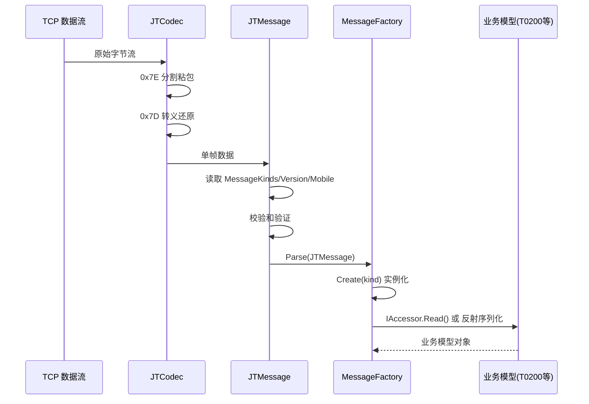
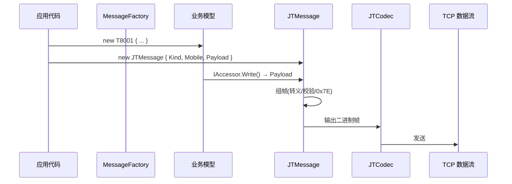
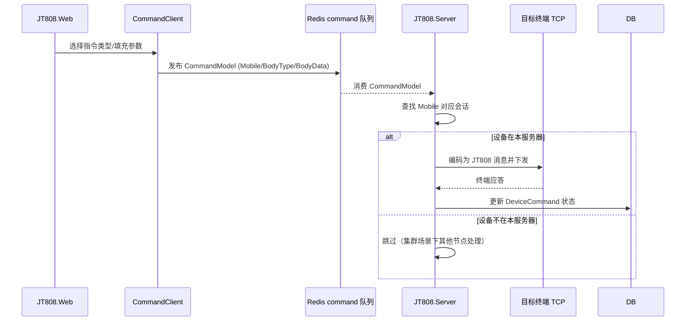
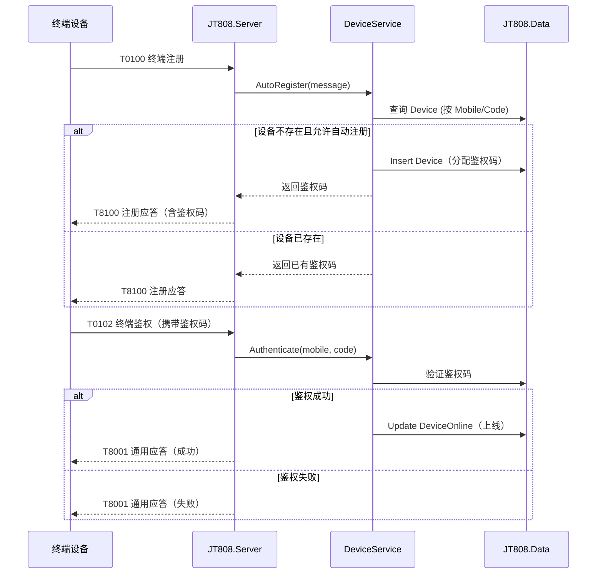

# NewLife.JT808 架构设计

> 版本：v2.2 | 日期：2026-10-20
> 需求对应：[需求文档](需求文档.md) | 功能清单：[功能清单](功能清单.md)

## 1. 整体架构

### 1.1 系统分层

NewLife.JT808 采用**三层架构（数据层 → 服务层 → 表现层）+ 协议基础设施**，参考 GPS808 中通科技成熟方案：

```
┌──────────────────────────────────────────────────────────────────┐
│                        表现层（JT808.Web）                         │
│  NewLife.Cube Areas: JT808Area / SafetyArea / PlatformArea       │
│  ┌──────────────────────────────────────────────────────────────┐ │
│  │  EntityController<Device>  EntityController<PositionData>    │ │
│  │  CommandClient（指令下发）  统计看板                          │ │
│  └──────────────────────────────────────────────────────────────┘ │
├──────────────────────────────────────────────────────────────────┤
│                        服务层                                     │
│  ┌────────────────────────┐  ┌─────────────────────────────────┐ │
│  │ JT808.Server（网关服务）│  │ JT808.Worker（消费服务）        │ │
│  │ ┌─ 5个指令处理器 ────┐ │  │ ┌─ 7个 Worker ──────────────┐ │ │
│  │ │ Normal/Info/Media  │ │  │ │ Position/Sensor/Event     │ │ │
│  │ │ Position/FileHandler│ │  │ │ ADAS/DSM/BSD/TirePressure│ │ │
│  │ └────────────────────┘ │  │ └──────────────────────────┘ │ │
│  │ ┌─ 6个业务服务 ─────┐  │  └─────────────────────────────────┘ │
│  │ │ Device/Queue/Biz   │  │                                    │
│  │ │ AlarmEvent/Map/Mq  │  │                                    │
│  │ └────────────────────┘  │                                    │
│  └────────────────────────┘                                     │
├──────────────────────────────────────────────────────────────────┤
│                        数据层（JT808.Data）                        │
│  XCode ORM - 7 个数据域，30+ 实体                                │
│  ┌──────┐ ┌──────┐ ┌──────┐ ┌──────┐ ┌──────┐ ┌──────┐ ┌──────┐ │
│  │ 核心域│ │ 安全域│ │平台域│ │ 车联域│ │ 行程域│ │地理域│ │统计域│ │
│  │GPS   │ │Safety│ │Platfm│ │IoC   │ │Segmnt│ │Locatn│ │Stat  │ │
│  └──────┘ └──────┘ └──────┘ └──────┘ └──────┘ └──────┘ └──────┘ │
├──────────────────────────────────────────────────────────────────┤
│                    协议基础设施（Newlife.JT808）                    │
│  JTMessage / MessageFactory / JTCodec / JT808Server              │
│  T0001~T8A00 / ADASInfo~TPMSInfo / Helper / Enums               │
└──────────────────────────────────────────────────────────────────┘
```

### 1.2 数据流架构

```
终端设备 (JT808 TCP)
    │ (TCP 808 端口)
    ▼
JT808Server (NetServer<JT808Session>)  ← GpsHostedService 管理生命周期
    │ JTCodec 解码 → 分包合并 → 消息路由
    ▼
指令处理器（5个）：Normal/Info/Media/Position/FileHandler
    │ 注册/鉴权/位置/媒体/文件 处理
    ▼
业务服务层
    ├─ DeviceService       设备认证、在线状态、位置保存
    ├─ QueueService        Redis Stream 消息生产（7个主题）
    ├─ AlarmEventService   报警事件聚合处理
    ├─ MediaService        多媒体文件管理
    └─ MapService          坐标转换（可选）
    │
    ├──→ 数据库（JT808.Data — XCode ORM）
    │     核心域(GPS) / 安全域(Safety) / 平台域(Platform)
    │
    ├──→ Redis Stream ──→ JT808.Worker（独立消费进程）
    │     PositionData / SensorData / EventData
    │     ADASAlarm / DSMAlarm / BSDAlarm / TirePressure
    │
    └──→ Redis 队列 ──→ 指令下发通道
          Web 端通过 CommandClient 发布到 Redis command 队列
          Server 端消费后下发到目标终端
    │
    ▼
JT808.Web (NewLife.Cube)
    └─ JT808 Area: 设备/产品/位置/在线/指令/报警 CRUD
    └─ Safety Area: ADAS/DSM/BSD/TPMS 报警管理
    └─ Platform Area: 转发/媒体/监管服务配置
    └─ 指令下发页面：设备详情页集成 Redis 指令下发
```

## 2. 核心组件

### 2.1 协议基础设施（Newlife.JT808 — 保持不变）

| 组件 | 命名空间 | 说明 |
|------|----------|------|
| `JTMessage` | `NewLife.JT808.Protocols` | JT/T 808 消息帧，负责 0x7E 帧解析、转义处理、异或校验、分包元数据 |
| `MessageFactory` | `NewLife.JT808.Protocols` | 消息工厂，维护 `MessageKinds↔Type` 映射，提供 `Create/Parse` 方法 |
| `MessageKinds` | `NewLife.JT808.Protocols` | 消息类型枚举（UInt16 底层值），覆盖全部标准消息ID |
| `TLV` | `NewLife.JT808.Protocols` | Type(4B)-Length(1B)-Value 通用编解码，用于 0x8103/0x0104 |
| `KLV` | `NewLife.JT808.Protocols` | Kind(1B)-Length(1B)-Value 通用编解码，用于 0x0200 附加信息 |
| `Helper` | `NewLife.JT808.Protocols` | 辅助类：GBK 编码注册、版本感知 Binary 创建、FastRead、ToJsonJT808 |
| `JT808Config` | `NewLife.JT808.Protocols` | 协议配置：版本、校验开关、加密密钥、工厂初始化 |

### 2.2 数据层（JT808.Data — 新增/扩展）

| 数据域 | 命名空间 | 连接名 | 主要实体 |
|--------|----------|--------|----------|
| 核心域 | `JT808.Data` | `GPS` | Product, Device, DeviceGroup, DeviceOnline, DeviceHistory, DeviceCommand, PositionData, RawData, MediaInfo, MediaRecord, Driver, TirePressure |
| 安全域 | `JT808.Data.Safety` | `Safety` | AlarmEvent, ADASAlarm, DSMAlarm, BSDAlarm, TPMSAlarm, AlarmFile, MediaResource |
| 平台域 | `JT808.Data.Platform` | `Platform` | ForwardServer, MediaServer, SuperviseServer, SuperviseOnline, CarList, SimCard |

> **说明**：架构图中标注的 7 个数据域（核心域/安全域/平台域/车联域/行程域/地理域/统计域）参考 GPS808 设计。当前已实现前 3 个域（核心域/安全域/平台域），合计 30+ 实体。车联域/行程域/地理域/统计域列为后续迭代，待数据模型完善后补充。

### 2.3 服务层（JT808.Server — 新增）

| 组件 | 类型 | 说明 |
|------|------|------|
| `NormalController` | IJT808Controller | 注册/鉴权/注销/心跳处理 |
| `InfoController` | IJT808Controller | 参数查询/设置/终端升级 |
| `MediaController` | IJT808Controller | 多媒体事件/存储检索 |
| `PositionController` | IJT808Controller | 位置上报/电子围栏/行驶记录 |
| `FileHandler` | IJT808Controller | 文件上传/补传/主动安全附件 |
| `DeviceService` | Singleton | 设备认证/在线/位置保存 |
| `QueueService` | Singleton | Redis Stream 生产者 |
| `AlarmEventService` | Singleton | 报警聚合处理 |
| `MediaService` | Singleton | 多媒体文件管理 |
| `GpsHostedService` | HostedService | JT808Server 生命周期 |
| `DeviceOnlineHostedService` | HostedService | 在线状态维护 |
| `PreheatHostedService` | HostedService | 启动预热 |
| `DataRetentionService` | HostedService | 数据过期清理 |

### 2.4 表现层（JT808.Web — 新增）

| Area | 说明 | 主要控制器 |
|------|------|-----------|
| `Areas/JT808/` | 核心管理 | DeviceController, ProductController, DeviceOnlineController, DeviceHistoryController, DeviceGroupController, DeviceParameterController, PositionDataController, DeviceCommandController, AlarmController, RawDataController, DriverController, MediaInfoController, MediaRecordController, TirePressureController |
| `Areas/Safety/` | 主动安全 | AlarmEventController, ADASAlarmController, DSMAlarmController, BSDAlarmController, TPMSAlarmController, AlarmFileController, MediaResourceController |
| `Areas/Platform/` | 平台管理 | ForwardServerController, MediaServerController, SuperviseServerController, SuperviseOnlineController, CarListController, SimCardController |

### 2.5 消费服务（JT808.Worker — 新增）

独立进程运行，通过 Redis Stream 消费组消费各主题数据。

| 组件 | 类型 | 说明 |
|------|------|------|
| `PositionWorker` | IHostedService | 消费 PositionData 主题，里程计算/坐标转换 |
| `SensorWorker` | IHostedService | 消费 SensorData 主题，传感器数据处理 |
| `EventWorker` | IHostedService | 消费 EventData 主题，设备事件处理 |
| `ADASAlarmWorker` | IHostedService | 消费 ADASAlarm 主题，ADAS 报警持久化和聚合 |
| `DSMAlarmWorker` | IHostedService | 消费 DSMAlarm 主题，DSM 报警持久化和聚合 |
| `BSDAlarmWorker` | IHostedService | 消费 BSDAlarm 主题，BSD 报警持久化和聚合 |
| `TirePressureWorker` | IHostedService | 消费 TirePressure 主题，胎压数据处理 |
| `QueueService` | Singleton | Redis Stream 消费者工厂，创建 `IProducerConsumer<T>` 实例 |

## 3. 关键流程

### 3.1 消息接收流水线



### 3.2 消息发送流水线



### 3.3 版本兼容机制

```
JTMessage.Version
  │
  ├── Version=0 (2013版)
  │   └── [JT2019] 特性标记的字段 → 跳过
  │
  └── Version=1 (2019版)
      ├── [JT2019] 特性标记的字段 → 读写
      ├── [FullString2(Version="2013")] → 跳过
      └── [FullString2(Version="2019")] → 读写
```

Binary 序列化器通过 `Binary.Version` 字符串（"2013"/"2019"）驱动特性条件判断，`Helper.CreateReader/CreateWriter` 根据 `JTMessage.Version` 自动设置。

### 3.4 Redis 消息队列流程

```mermaid
sequenceDiagram
  participant TCP as TCP 终端
  participant Handler as 指令处理器
  participant QueueS as QueueService(生产者)
  participant Redis as Redis Stream
 参与者的 Worker as JT808.Worker(消费者)
 参与者的 DB as MySQL

  TCP->>Handler: 位置上报(T0200)
  Handler->>Handler: 解析附加信息
  Handler->>QueueS: AddPosition()
  QueueS->>Redis: PositionData Stream
  Handler->>DB: SaveAsync(PositionData)

  注：Worker 是独立进程，通过 Redis Stream 消费组消费

  Redis->>Worker: 消费 PositionData
  Worker->>Worker: 里程计算/坐标转换
  Worker->>DB: 写入处理结果
```

### 3.5 指令下发流程（Redis 队列模式）



### 3.6 设备注册/鉴权流程



## 4. 序列化策略

### 4.1 反射自动序列化（简单消息体）

适用场景：属性类型为基础类型、无特殊编解码逻辑、无版本差异字段。

```csharp
[MessageKind(MessageKinds.平台通用应答)]
public class T8001
{
    public UInt16 Sequence { get; set; }
    public MessageKinds Kind { get; set; }
    public ResultKinds Result { get; set; }
}
```

序列化过程：
1. `Binary.TryWrite(null, ref obj)` 反射遍历属性
2. 检查 `[FieldSize]`、`[FullBytes]`、`[JT2019]` 等特性
3. 按声明顺序读写，大端序

### 4.2 IAccessor 手动序列化（复杂消息体）

适用场景：多版本字段长度不同、嵌套结构、需要特殊处理的分支逻辑。

```csharp
[MessageKind(MessageKinds.终端注册)]
public class T0100 : IAccessor
{
    public Boolean Read(Stream stream, Object context)
    {
        var reader = Helper.CreateReader(stream, context as JTMessage);
        // 手写精确的读取逻辑，可访问 header.Version 判断版本
    }
}
```

选择依据：
- 反射序列化优先级更高（减少样板代码）
- 仅当反射无法满足时（版本差异、嵌套读取、条件跳过）才降级为 IAccessor

## 5. 设计决策

### 5.1 协议库决策（Newlife.JT808 — 保持不变）

| 决策 | 选项 | 选择 | 理由 |
|------|------|------|------|
| 序列化模式 | 全反射 vs 全手动 vs 双模式 | 双模式 | 大多数消息简单可用反射，少数复杂消息需要精确控制 |
| 版本兼容 | if分支 vs 特性驱动 | 特性驱动 | 声明式的 `[JT2019]` 比内联if更清晰，减少遗漏 |
| 命名空间 | `NewLife.IoT` vs `NewLife.JT808` | `NewLife.JT808` | JT808 是独立协议领域，与 Modbus 平等 |
| 目标框架 | net7.0 vs 多目标 | 多目标 | 与 NewLife 生态一致，最大化兼容性 |
| 网络层 | 内置 vs 单独包 | 内置（同一包） | 粘包编解码是协议库常用功能，无需单独包 |

### 5.2 平台架构决策（新增）

| 决策 | 选项 | 选择 | 理由 |
|------|------|------|------|
| 消息队列 | DefaultMsgQueue vs Redis Stream | **Redis Stream** | 对标 GPS808 成熟模式，消费组+ACK，跨进程解耦 |
| MQ 适配器位置 | 核心库 vs Server | **JT808.Server** | RocketMQ/Kafka 适配器只服务本平台，核心协议包不携带 MQ 客户端依赖，避免所有 NuGet 使用者被动引入 |
| 指令下发 | StarFactory 事件总线 vs Redis 队列 | **Redis 队列** | 解耦 Web 和 Server，不依赖星尘，更适合独立部署 |
| 数据域划分 | 单 xml vs 多 xml 分域 | **多 xml 分域** | 实体超过 30 张，按域拆分更清晰（GPS/Safety/Platform） |
| 主键策略 | Int32 自增 vs Int64 雪花 | **混合**：基础表 Int32 自增，大数据表 Int64 雪花 | PositionData/AlarmEvent 等高频表用雪花避免分片冲突 |
| 服务端启动 | 控制台直启 vs HostedService | **HostedService** | 统一生命周期管理，预热机制，优雅退出 |
| Server 框架 | 纯控制台 vs WebApplication | **WebApplication** | 内置健康检查、配置系统，与 ASP.NET 生态一致 |
| Worker 部署 | 合并在 Server vs 独立进程 | **独立进程** | 解耦计算压力，可独立扩缩容，对标 GpsWorker |
| Web 框架 | 原生 MVC vs Cube | **Cube（魔方）** | 零代码 CRUD，Area 自动生成，字段配置灵活 |
| 数据库连接 | 单库 vs 多连接串 | **多连接串 MapTo** | 核心 GPS 独立库，Safety/Platform 可 MapTo 共享物理库或独立 |
| 分布式缓存 | 无 vs RedisCacheProvider | **RedisCacheProvider** | 设备在线/会话状态需要分布式共享 |
| 星尘集成 | 可选 vs 强制 | **所有项目均注册** | 统一服务治理，配置中心，健康监测 |

### 5.3 跨版本升级决策（NewLife.Core v12）

| 决策 | 选项 | 选择 | 理由与影响 |
|------|------|------|------------|
| 消息契约 | 适配新 `IMessage` vs 解除实现 | **解除实现** | Core v12 的 `IMessage` 表达请求/响应方向语义，与 JT808 的"消息ID语义"冲突；`JTMessage` 保留自有 `Kind`/`Reply`，帧读写走 `Read(IPacket)`。影响面：`JTMessage` 不再可隐式当作 `NewLife.Messaging.IMessage`，`CreateReply()` 返回类型收窄为 `JTMessage` |
| 目标框架 | 维持 4 个 vs 增加 net8.0 | **增加 net8.0** | 只有 net8.0+ 才运行 AOT/裁剪分析器，且现代宿主可直接使用原生资产；`net45/net461/netstandard2.0/2.1` 保持不变 |
| AOT 策略 | 纯声明 vs 冒烟验证 | **冒烟验证** | 消息工厂依赖反射扫描，AOT 下需保留协议库程序集；`AotSmoke` 以 `TrimmerRootAssembly` 固化该要求并用 16 个场景回归 |
| 本地化 | 卫星程序集 vs 编译期词表 | **编译期词表** | 沿用 Core v12 源生成器：单 DLL、Deflate 压缩、缺译文回退英文、AOT 安全 |
| 运行时文案 | 中文 vs 英文源文 | **英文源文** | 日志由 Core `Logger.FormatMessage` 统一翻译；异常在抛出点翻译，避免日志与语言配置耦合 |
