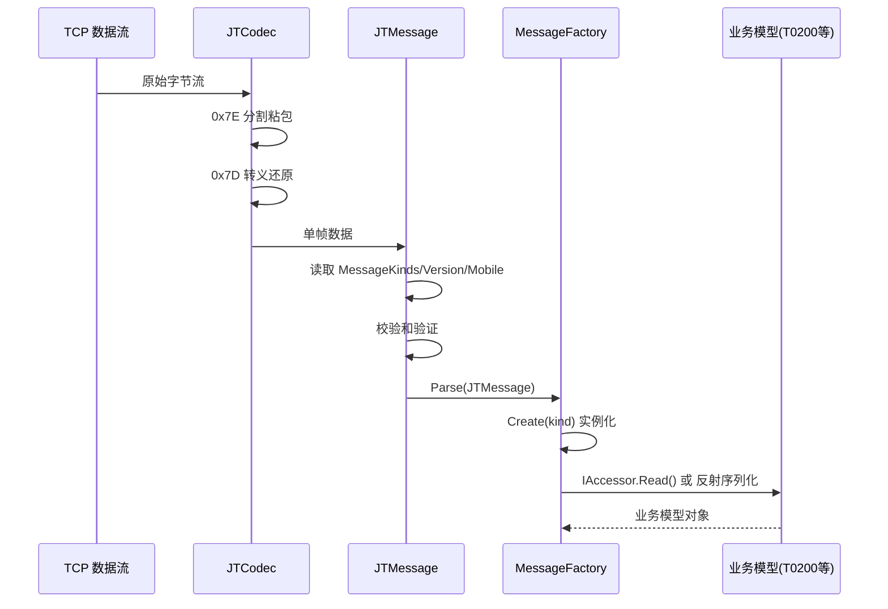
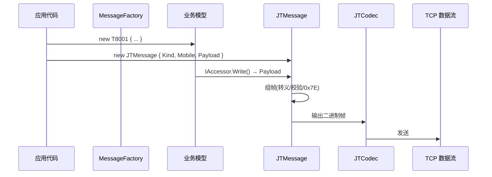

# NewLife.JT808 架构设计

> 版本：v1.0 | 日期：2026-07-12
> 需求对应：[需求文档](需求文档.md) | 功能清单：[功能清单](功能清单.md)

## 1. 整体架构

JT/T 808 协议库采用单项目两层结构（协议层 + 模型层），无数据层和服务层。所有类型位于 `NewLife.JT808` 命名空间下。

```
┌──────────────────────────────────────────────────┐
│                    应用层                          │
│   (使用者代码：JT808Client / 自定义处理器)          │
├──────────────────────────────────────────────────┤
│   JT808Client        JTCodec       Handler路由    │
│   (TCP客户端)       (粘包编解码)    (消息分发)      │  网络通信层
├──────────────────────────────────────────────────┤
│   MessageFactory     JTMessage     JT808Config    │
│   (消息工厂)         (消息帧)      (配置)          │  协议基础设施
├──────────────────────────────────────────────────┤
│   TLV / KLV          BCDString / BCDTime         │
│   FullBytes / FullString2 / JT2019               │  序列化特性
├──────────────────────────────────────────────────┤
│   T0001 ... T8A00    ADASInfo ... TPMSInfo       │
│   (标准消息体)        (苏标扩展信息)               │  业务模型
├──────────────────────────────────────────────────┤
│   Helper    MessageKinds    PositionAlarms ...   │
│   (辅助)    (消息枚举)       (业务枚举)            │  辅助工具
└──────────────────────────────────────────────────┘
```

**核心设计原则**：
- 协议帧（JTMessage）与消息体（Txxxx）分离，各自独立序列化
- 序列化方式按复杂度分级：简单消息反射自动，复杂消息手动 IAccessor
- 版本差异通过特性驱动，避免代码分支

## 2. 核心组件

| 组件 | 命名空间 | 说明 |
|------|----------|------|
| `JTMessage` | `NewLife.JT808.Protocols` | JT/T 808 消息帧，负责 0x7E 帧解析、转义处理、异或校验、分包元数据 |
| `MessageFactory` | `NewLife.JT808.Protocols` | 消息工厂，维护 `MessageKinds↔Type` 映射，提供 `Create/Parse` 方法 |
| `MessageKinds` | `NewLife.JT808.Protocols` | 消息类型枚举（UInt16 底层值），覆盖全部标准消息ID |
| `TLV` | `NewLife.JT808.Protocols` | Type(4B)-Length(1B)-Value 通用编解码，用于 0x8103/0x0104 |
| `KLV` | `NewLife.JT808.Protocols` | Kind(1B)-Length(1B)-Value 通用编解码，用于 0x0200 附加信息 |
| `Helper` | `NewLife.JT808.UtilTool` | 辅助类：GBK 编码注册、版本感知 Binary 创建、FastRead、ToJsonJT808 |
| `JT808Config` | `NewLife.JT808.Protocols` | 协议配置：版本、校验开关、加密密钥、工厂初始化 |

## 3. 关键流程

### 3.1 消息接收流水线



### 3.2 消息发送流水线



### 3.3 版本兼容机制

```
JTMessage.Version
  │
  ├── Version=0 (2013版)
  │   └── [JT2019] 特性标记的字段 → 跳过
  │
  └── Version=1 (2019版)
      ├── [JT2019] 特性标记的字段 → 读写
      ├── [FullString2(Version="2013")] → 跳过
      └── [FullString2(Version="2019")] → 读写
```

Binary 序列化器通过 `Binary.Version` 字符串（"2013"/"2019"）驱动特性条件判断，`Helper.CreateReader/CreateWriter` 根据 `JTMessage.Version` 自动设置。

## 4. 序列化策略

### 4.1 反射自动序列化（简单消息体）

适用场景：属性类型为基础类型、无特殊编解码逻辑、无版本差异字段。

```csharp
[MessageKind(MessageKinds.平台通用应答)]
public class T8001
{
    public UInt16 Sequence { get; set; }
    public MessageKinds Kind { get; set; }
    public ResultKinds Result { get; set; }
}
```

序列化过程：
1. `Binary.TryWrite(null, ref obj)` 反射遍历属性
2. 检查 `[FieldSize]`、`[FullBytes]`、`[JT2019]` 等特性
3. 按声明顺序读写，大端序

### 4.2 IAccessor 手动序列化（复杂消息体）

适用场景：多版本字段长度不同、嵌套结构、需要特殊处理的分支逻辑。

```csharp
[MessageKind(MessageKinds.终端注册)]
public class T0100 : IAccessor
{
    public Boolean Read(Stream stream, Object context)
    {
        var reader = Helper.CreateReader(stream, context as JTMessage);
        // 手写精确的读取逻辑，可访问 header.Version 判断版本
    }
}
```

选择依据：
- 反射序列化优先级更高（减少样板代码）
- 仅当反射无法满足时（版本差异、嵌套读取、条件跳过）才降级为 IAccessor

## 5. 设计决策

| 决策 | 选项 | 选择 | 理由 |
|------|------|------|------|
| 项目分层 | 单层 vs 两层 vs 三层 | 单项目两层 | 协议库无数据库/业务，两层（协议+模型）足够 |
| 序列化模式 | 全反射 vs 全手动 vs 双模式 | 双模式 | 大多数消息简单可用反射，少数复杂消息需要精确控制 |
| 版本兼容 | if分支 vs 特性驱动 | 特性驱动 | 声明式的 `[JT2019]` 比内联if更清晰，减少遗漏 |
| 命名空间 | `NewLife.IoT` vs `NewLife.JT808` | `NewLife.JT808` | JT808 是独立协议领域，与 Modbus 平等 |
| 目标框架 | net7.0 vs 多目标 | 多目标 | 与 NewLife 生态一致，最大化兼容性 |
| 网络层 | 内置 vs 单独包 | 内置（同一包） | 粘包编解码是协议库常用功能，无需单独包 |
| 服务端 | 内置 vs 排除 | 排除 | 服务端涉及数据库和业务逻辑，超出协议库范围 |
| 音视频 | 完整 vs 仅基础 | 仅基础消息体 | JT/T 1078 音视频完整实现工程量大，暂排除 |
